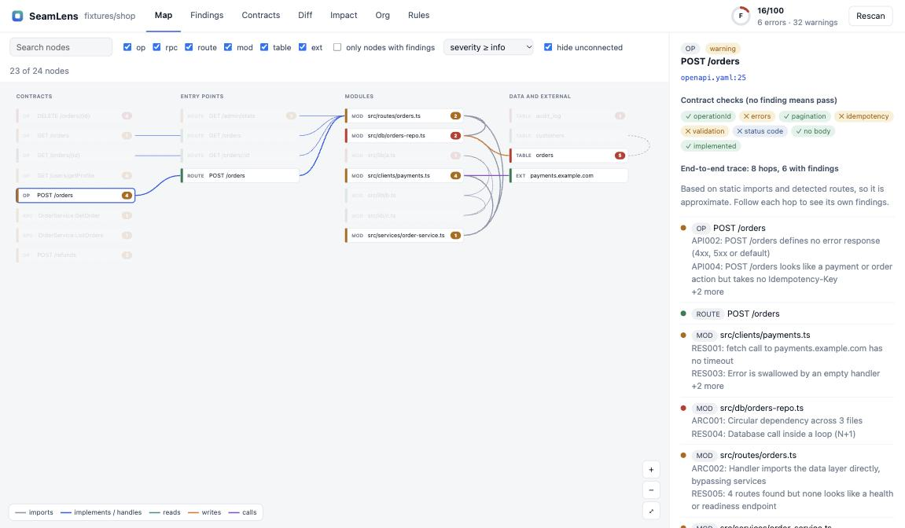

# SeamLens

**Visual end-to-end map of your API, gRPC and database contracts, with system-design checks, breaking-change detection, and AI-coding-agent impact analytics. CLI, local web UI, and MCP server.**

[](LICENSE)
[](https://modelcontextprotocol.io)



A *seam* is the boundary between two parts of a system: an HTTP API, a gRPC service, a table schema, a module import. Seams are where systems break. SeamLens finds them in your repository, draws them, and checks them against the practices that keep production up.

Everything runs **locally**. Nothing is uploaded, no code from your repository is executed, and there is no LLM in the analysis path, so the same repo at the same commit always gives the same report.

## What you get

| | Question | Command |
|---|---|---|
| **Map** | What does the system look like end to end, and are its contracts sound? | `seamlens serve` · `seamlens check` |
| **Diff** | Will this change break a consumer of our API or protobuf? | `seamlens diff --base main` |
| **Impact** | Are AI-coding-agent commits better or worse than the rest of the work? | `seamlens impact` |
| **Org** | Where is knowledge concentrated, and where is the delivery bottleneck? | `seamlens org` |
| **Bench** | Can I turn my own history into coding-agent evaluations? | `seamlens bench generate` |

## Quick start

```bash
npx seamlens serve .        # visual map in your browser (localhost only)
npx seamlens check .        # findings in the terminal
npx seamlens diff . --base main
```

Zero configuration. It reads OpenAPI (`.yaml`/`.json`), protobuf (`.proto`), SQL (`.sql`, and `CREATE TABLE` inside TypeScript, JavaScript and Python strings), HTTP routes (Express-like, Fastify, Hono, NestJS, FastAPI, Flask, raw Node), and the import graph.

## The visual workflow

`seamlens serve` opens a map with four lanes: **Contracts → Entry points → Modules → Data and external**. Each node carries its worst finding as a coloured stripe and a count.

Select an operation and the **end-to-end trace** lights up everything it depends on: the route that implements it, the handler module, its transitive imports, the tables it reads and writes, and the outbound hosts it calls. The side panel gives a contract checklist for the operation and a list of every hop with its own findings, so you can see *where along the path* the design is weak. Findings open in a code viewer at the exact line with the reason and the fix.

Other views: Findings, Contracts, Diff, Impact, Org, and the Rules catalogue.

## Checks (37 rules)

| Area | Examples |
|---|---|
| **HTTP / OpenAPI** | missing or duplicate `operationId`; no error response or inconsistent error shapes; unpaginated collections; payment-like `POST` without an idempotency key; no authentication declared; no versioning; mixed `camelCase`/`snake_case`; unbounded input; no `429`; write without a validation response; `GET`/`DELETE` with a body |
| **gRPC / Protobuf** | unversioned package; enum without `*_UNSPECIFIED = 0`; shared request/response message; **removed fields not `reserved`**; unpaginated `List*`; money as `float` |
| **Database** | table without primary key; unindexed foreign key; money as `FLOAT`; destructive migration in one step (expand/contract); `ADD COLUMN … NOT NULL` without default |
| **Architecture** | circular dependencies (with the path); layer violations (configurable); god modules; deep imports into sibling packages. Type-only imports are ignored because they are erased at compile time |
| **Resilience** | outbound calls with no timeout; retries without backoff; swallowed errors; calls and queries inside loops (N+1); no health endpoint |
| **Drift** | operations documented but not implemented; routes implemented but undocumented |

`seamlens rules` lists them; `seamlens rules API003` explains one. Every finding carries the file, line, quoted evidence, why it matters, how to fix it, and a confidence level. Detection of routes and calls is heuristic and says so.

The **contract-health score** (0 to 100) decays smoothly with the number and severity of findings, with a cap per rule so one noisy rule cannot dominate. Use it for trend and gating, not for comparing unrelated repositories.

## Breaking-change detection

```bash
seamlens diff --base origin/main          # exit code 1 if anything breaks
```

It reads the old contracts with `git show` (nothing is checked out) and compares semantically, so it knows that a new *required* request field breaks clients but a new *optional* one does not, that removing a response property breaks consumers, that narrowing `maxLength` breaks callers, and that a protobuf field removed without `reserved` can corrupt old clients when its number is reused. Results are `breaking`, `potentially-breaking` or `safe`.

## Agent impact: methodology and limits

```bash
seamlens impact . --since 180
```

Commits are attributed to an AI coding agent from commit metadata: `Co-authored-by` / `Assisted-by` trailers naming Claude, Copilot, Cursor, Codex, Gemini, Devin, Aider and similar; "Generated with …" lines; agent author e-mails; an `aider:` prefix; plus your own patterns in `.seamlens.json`. A commit that merely *mentions* an agent does not count. Bots are excluded.

For each cohort it reports test-touch rate, how often commits are later reverted, fix-follow-up within 7 days (a proxy for escaped defects), and rework within 14 days, each with a **95% Wilson confidence interval**. A comparison needs at least 30 commits per cohort and non-overlapping intervals before it says one side is better or worse; otherwise it says *insufficient data* or *no detectable difference*.

What it will not tell you, and says so in every report: attribution is a **lower bound** (unmarked agent work lands in "other"), squash merges hide authorship, commit size is not value, and fix-follow-up is a proxy, not a measured defect. It never ranks people.

## Org metrics

```bash
seamlens org . --github owner/repo
```

Knowledge concentration (**bus factor** per area), change hotspots, weekly cadence, tags, and, through your own authenticated `gh` CLI, PR time-to-merge, time-to-first-review, PR size, review load and stale PRs. Authors appear as stable pseudonyms unless you pass `--names`.

## Benchmark tasks from your own history

```bash
seamlens bench generate . --out tasks.json
seamlens bench validate . --tasks tasks.json --test-cmd "npm test" --out valid.json
seamlens bench run      . --tasks valid.json --test-cmd "npm test" --agent-cmd "my-agent"
```

`generate` finds fix commits that ship with tests and packages each as a SWE-bench-style task (base commit, problem statement, gold patch, hidden test patch, difficulty). `validate` proves each task in a disposable git worktree: the tests must **fail** on the base commit and **pass** with the fix. `run` hands each validated task to your agent command, discards any edit the agent made to the hidden tests, applies the real tests, and reports pass/fail plus a **scope-creep ratio**: the share of files the agent changed that the reference fix did not touch. It separates "solved narrowly" from "solved by rewriting half the repo". `validate` and `run` execute commands you supply, so they are CLI-only, run with a scrubbed environment and a timeout, and are **not a sandbox**. Use a container or VM for untrusted agents.

## MCP server

```json
{ "mcpServers": { "seamlens": { "command": "npx", "args": ["-y", "seamlens", "seamlens-mcp"], "env": { "SEAMLENS_ROOTS": "/Users/you/Developer" } } } }
```

Eight read-only tools: `scan_contracts`, `check_contracts`, `explain_rule`, `contract_diff`, `impact_report`, `org_metrics`, `generate_benchmark_tasks`, `open_visual_map`. No tool executes commands. Set `SEAMLENS_ROOTS` to confine which directories the server may read. Responses are structured, size-capped, and marked as untrusted data, which reduces the risk of an instruction hidden in a repository file being followed by the host model. See [SECURITY.md](SECURITY.md).

## CI

```yaml
- uses: vikasny30/seamlens@v0
  with: { fail-on: error, base: "origin/${{ github.base_ref }}" }
- uses: github/codeql-action/upload-sarif@v3
  with: { sarif_file: seamlens.sarif }
```

`--format sarif` produces SARIF 2.1.0 so findings appear as annotations on the pull request. See [docs/github-action-example.yml](docs/github-action-example.yml).

## Configuration

Optional `.seamlens.json` at the repository root: disabled rules, layers, base path for mounted routers, extra agent patterns, ignore globs. See [docs/seamlens.config.example.json](docs/seamlens.config.example.json).

## Honest limitations

- Route, outbound-call and table-access detection is heuristic. Findings carry a confidence label, and each rule can be disabled.
- GraphQL, AsyncAPI, ORM model introspection and `tsconfig` path aliases are not supported yet (see the roadmap in [docs/DESIGN.md](docs/DESIGN.md)).
- Only JavaScript/TypeScript and Python get code-level analysis; contract files work for any language.
- The impact report is only as good as your commit metadata, and small cohorts give no verdict by design.

## Design

[docs/DESIGN.md](docs/DESIGN.md) covers the architecture, the data model, every rule, the statistics, the threat model, and the roadmap.

## Development

```bash
npm install
npm test          # unit, fixture, git, web-security and MCP end-to-end tests
npm run build
```

## License

Apache-2.0. Created by Vikas Shivpuriya.
