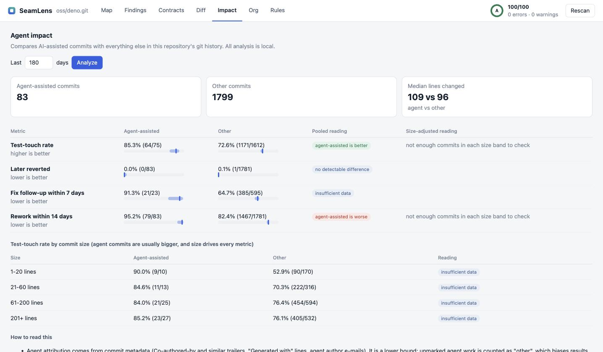

# Agent-assisted commits in two open-source repositories

Measured with `seamlens impact` v0.1.0 on public git history. Everything below is reproducible from the commands at the end.

| | denoland/deno | huggingface/transformers |
|---|---|---|
| History analysed | 2025-09-05 to 2026-10-06 | 2025-06-06 to 2026-10-09 |
| Commit analysed (HEAD) | `a18ce33715e3` | `536ecc007387` |
| Non-merge commits | 3,127 | 3,908 |
| Carrying an AI-agent trailer | **427 (13.7%)** | **236 (6.0%)** |
| Other commits | 2,686 | 3,635 |
| Bot commits (excluded) | 14 | 37 |
| Median lines changed, agent vs other | 113 vs 87 | 45 vs 36 |

"Carrying an AI-agent trailer" means a `Co-authored-by` / `Assisted-by` trailer or a "Generated with …" line naming an agent. In both repositories the visible agent is mostly Claude. Agent use without a trailer is counted as "other", so these are lower bounds.



(The screenshot is a 180-day window; the tables below use 400 days.)

## Pooled comparison (what a naive tool reports)

| Metric | Deno agent | Deno other | Transformers agent | Transformers other |
|---|---|---|---|---|
| Test-touch rate (commits that change source also change tests) | 77.5% (73-81) | 70.8% (69-73) | 59.4% (52-67) | 44.6% (43-46) |
| Later reverted | 0.7% (0-2) | 0.5% (0-1) | 0.5% (0-3) | 0.5% (0-1) |
| Fix follow-up within 7 days | 65.4% (57-73) | 61.8% (59-65) | 46.8% (38-56) | 44.1% (42-46) |
| Rework within 14 days | 85.5% (82-89) | 81.6% (80-83) | 78.0% (72-83) | 77.1% (76-78) |

95% Wilson intervals in parentheses. Pooled, agent-assisted commits look better on test-touch in **both** repositories (non-overlapping intervals). The other three metrics show no detectable difference.

## The same comparison inside commit-size bands

Agent commits are larger, and bigger commits touch tests more often, so size is a confounder.

**Deno, test-touch rate**

| Size | Agent | Other | Reading |
|---|---|---|---|
| 1-20 lines | 61.0% (25/41) | 41.5% (135/325) | no detectable difference |
| 21-60 | 79.5% (70/88) | 71.9% (332/462) | no detectable difference |
| 61-200 | 81.7% (103/126) | 76.5% (603/788) | no detectable difference |
| 201+ | 77.1% (108/140) | 76.6% (586/765) | no detectable difference |

**Transformers, test-touch rate**

| Size | Agent | Other | Reading |
|---|---|---|---|
| 1-20 lines | 27.3% (12/44) | 9.2% (87/944) | agent-assisted is better |
| 21-60 | 58.8% (20/34) | 46.4% (264/569) | no detectable difference |
| 61-200 | 77.1% (27/35) | 61.9% (307/496) | no detectable difference |
| 201+ | 76.6% (36/47) | 76.1% (575/756) | no detectable difference |

## What this does and does not show

- **Shows:** the pooled "agent commits touch tests more" result is mostly, and in Deno possibly entirely, a commit-size effect. A tool that reports only the pooled number would draw the wrong conclusion.
- **Does not show:** that agents do not help. Point estimates favour agent commits in every Deno band and in three of four Transformers bands; the per-band samples (35 to 140 agent commits) are too small to confirm or rule out a modest real effect. In Transformers, the smallest commits (1-20 lines) show a real gap (27% vs 9%).
- **Reverts** are rare in both repositories (about 0.5%), so there is almost no signal there.
- **Fix follow-up (46% to 65%) and rework (77% to 86%)** are so high for both groups that they cannot separate anything. In a busy repository most files are touched again within days. These two proxies saturate and should not be used to compare cohorts in such repositories.
- Commits are not value, and two repositories are not a population. No individual is named or ranked.

## Reproduce

```bash
git clone --bare --single-branch --shallow-since=2025-06-01 https://github.com/denoland/deno.git deno.git
git -C deno.git rev-parse HEAD            # the run above used a18ce33715e30cd2b0d99c7e322ef11a65490e4d
npx seamlens impact ./deno.git --since 400 --format md
```

A bare, shallow clone downloads history without checking out any file, and `seamlens impact` only reads git metadata, so nothing from the analysed repository is executed. Results shift slightly with the clone date and the `--since` window.
